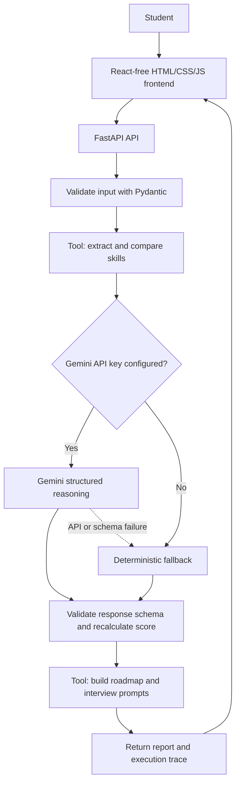

# CareerPilot AI — Hackathon Build

CareerPilot AI is an Education & Career AI prototype that compares a resume with a target job description, identifies skill overlap and gaps, creates a learning roadmap, and generates interview practice prompts. It supports text-based PDF resumes.

> **Hackathon warning:** this is a proposed concept, not confirmation of the official Ziro.Digital assigned problem statement. Confirm the official brief and adapt the solution before submitting.

## What is implemented

- Responsive web dashboard.
- Resume paste or upload: PDF, TXT, MD, CSV.
- PDF text extraction with `pypdf` (selectable text only; scanned PDFs need OCR).
- Deterministic skill extraction/comparison tool.
- Optional real Gemini API reasoning and structured JSON output.
- Agent workflow with explicit steps, tool execution, output validation, and safe deterministic fallback.
- Personalized roadmap and interview practice prompts.
- Execution trace visible in the UI.
- JSON report download.
- FastAPI health endpoint and Swagger docs.
- Automated tests for deterministic workflow, AI path (mocked), fallback, and upload validation.

## Windows setup

Requirements: Python 3.10+ (Python 3.11 recommended), Windows 10/11.

1. Extract the project.
2. Copy `.env.example` to `.env`.
3. Open `.env` and replace the placeholder with your Gemini API key. Do not share or commit this key.
4. Double-click `run.bat`.

Or run in Command Prompt from the project root:

```bat
py -3 -m venv .venv
.venv\Scripts\activate
pip install -r requirements.txt
copy .env.example .env
notepad .env
python -m uvicorn app.main:app --host 127.0.0.1 --port 8000 --reload
```

Important: `run.bat` reads `.env` and installs dependencies. If you start Uvicorn manually, set `GEMINI_API_KEY` in that Command Prompt session first, or use `run.bat`.

Open:
- App: http://127.0.0.1:8000
- API docs: http://127.0.0.1:8000/docs
- Health: http://127.0.0.1:8000/api/health

Stop with Ctrl+C.

## Configure Gemini

Create an API key through Google's official AI Studio and add it to `.env`:

```text
GEMINI_API_KEY=your_real_key_here
GEMINI_MODEL=gemini-2.5-flash
PORT=8000
```

Never commit `.env`. `.gitignore` excludes it. If no key is configured, the application deliberately uses deterministic fallback and labels that mode in the UI. If Gemini errors, the API returns a fallback result and the trace shows a warning rather than pretending the model succeeded.

## Agent architecture



### Agent behavior

1. **Validate inputs:** reject short or oversized inputs.
2. **Tool — compare skills:** deterministic keyword extraction gives an auditable baseline.
3. **Reasoning — Gemini:** when configured, Gemini improves the summary, prioritization, roadmap, and interview prompts using supplied evidence.
4. **Tool — verify report:** validate the response schema and recalculate the match score from supported skill evidence.
5. **Tool — return next actions:** deliver the roadmap, questions, and trace.

This is a controlled tool-using workflow, not an unrestricted autonomous agent. It does not apply to jobs, send messages, or take external actions.

## Run tests

```bat
.venv\Scripts\activate
pytest -q
```

Tests mock the Gemini call and do not require a paid API call.

## Manual test plan

1. **Valid resume + job description:** paste or upload resume text, paste a role description, analyze, and confirm matched skills/gaps.
2. **PDF upload:** select a text-based PDF under 5 MB and confirm extracted text appears in the resume box.
3. **Skill gaps:** use a job description requiring Docker and Spark when those skills are absent from the resume.
4. **Missing API key:** verify the UI labels demo/fallback mode and the report says Gemini was not configured.
5. **Gemini failure:** temporarily use an invalid key and confirm the fallback result and warning trace appear.
6. **Unsupported file:** try DOCX and confirm it is rejected.
7. **Scanned PDF:** confirm a clear OCR limitation message is displayed.

## Deployment guidance

For a quick deployment, host the FastAPI app on a Python-compatible service such as Render or Railway. Because the frontend is served by FastAPI at `/`, one web service is enough for the initial version.

Generic deployment steps:
1. Push this project to a GitHub repository.
2. Create a new Python web service from that repository.
3. Build command: `pip install -r requirements.txt`
4. Start command: `uvicorn app.main:app --host 0.0.0.0 --port $PORT`
5. Set environment variables in the host dashboard: `GEMINI_API_KEY` and `GEMINI_MODEL=gemini-2.5-flash`.
6. Deploy and open `/api/health`; verify `ai_enabled` is true.
7. Test PDF upload and the entire analysis flow on the public URL.
8. Do not put API keys in GitHub or frontend JavaScript.

Local Windows uses `run.bat`; hosted services use their own start command.

## Submission package checklist

- [ ] Official assigned problem statement confirmed and solution aligned to it.
- [ ] Project name and tools listed accurately.
- [ ] Live demo URL verified by opening it in a private/incognito window.
- [ ] GitHub repository is public or reviewer-accessible; no secrets committed.
- [ ] 5–7 slide presentation prepared.
- [ ] Architecture diagram matches the actual implementation.
- [ ] Test cases include inputs, expected results, actual results, and screenshots.
- [ ] 2–3 minute demo video recorded from the live application.
- [ ] Team photo uploaded.
- [ ] LinkedIn post published and official Ziro Digital page tagged via @mention.
- [ ] LinkedIn post URL and screenshot included.
- [ ] Team leader reviews and finalizes submission.

## Suggested 7-slide pitch deck

1. Problem and target users — students need clearer evidence-based paths from skills to role requirements.
2. Solution — CareerPilot AI and its main user journey.
3. Live product walkthrough — resume, job description, match report.
4. Agent architecture — tools, Gemini reasoning, validation, fallback.
5. Technical implementation — FastAPI, Gemini API, Pydantic, pypdf, browser frontend.
6. Testing and evidence — show actual passing test output and verified live behavior; never invent metrics.
7. Impact, limitations, next steps — explain the prototype honestly and propose future improvements.

## 2–3 minute demo script

- 0:00–0:20 — Explain the target user and problem.
- 0:20–0:45 — Upload a sample text-based PDF resume and paste a job description.
- 0:45–1:20 — Run analysis and point out the execution trace, matched skills, and gaps.
- 1:20–1:50 — Show the learning roadmap and interview questions.
- 1:50–2:15 — Show the architecture and test evidence.
- 2:15–2:30 — State current limitations and the intended next step.

## Current limitations

- Keyword extraction is limited to a built-in skill bank.
- Gemini quality depends on model availability, key validity, and API quota.
- The score is keyword overlap, not a probability of getting hired.
- No login, persistent database, OCR for scanned PDFs, or external job-search integrations.
- This project has not been deployed from this environment; verify deployment yourself.
